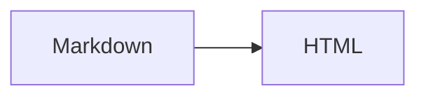

# Official plugins

A Markdown plugin extends the content compiler through remark/rehype transforms, document metadata, and asset declarations. Transforms run when Markdown or MDX is compiled; plugins can also declare CSS and browser scripts. Deployed sites need no Node.js plugin service, but features such as Mermaid still load a runtime in the reader's browser.

For example, `math()` turns `$E = mc^2$` into KaTeX HTML during the build. `mermaid()` loads its diagram client only on pages that contain executable Mermaid fences. A search provider has a different lifecycle: it receives the completed site and writes a site-wide index instead of transforming one document.

Official plugins are published in `@canofold/plugins`:

:::code-group[Package manager]

```bash title="pnpm"
pnpm add -D @canofold/plugins
```

```bash title="npm"
npm install --save-dev @canofold/plugins
```

```bash title="yarn"
yarn add --dev @canofold/plugins
```

:::

## Available capabilities

| Factory | Configuration | Purpose | Extra requirement |
|---|---|---|---|
| `externalLinks()` | `markdown.plugins` | Add safe attributes to external links | None |
| `linkCard()` | `markdown.plugins` | Render a standalone link as a card | None |
| `readingTime()` | `markdown.plugins` | Show reading time below the title | None |
| `math()` | `markdown.plugins` | Render mathematical notation | Import `@canofold/plugins/math.css` when using the Markdown package directly |
| `mermaid()` | `markdown.plugins` | Render Mermaid diagrams | Install `mermaid` |
| `plantUml()` | `markdown.plugins` | Render PlantUML diagrams | Configure a trusted `server` or host renderer |
| `kroki()` | `markdown.plugins` | Render Graphviz and D2 through Kroki | Configure a trusted `server` or a host renderer |
| `pagefind()` | `search.provider` | Build a Pagefind search index | Install `pagefind` |

## Configure and use plugins

For static sites, install these packages as development and build dependencies, then deploy their generated browser assets with the site. Configure only the capabilities the site needs; when enabling Mermaid or Pagefind, install the corresponding dependency as well:

```bash
pnpm add -D mermaid@^12.2.0 pagefind
```

Mermaid 12 requires Node 22.12+, Safari 17.4+, or equivalent ES2024 browser support. Canofold defaults to Dagre layout and the Classic look; authored diagram configuration can still select ELK or another layout. The consuming project installs Mermaid separately; it is not bundled inside `@canofold/plugins`. Rebuild and deploy after updating it so browsers receive the new runtime. Consult the installed plugin's `peerDependencies` for supported versions and check dependency security advisories as well.

```ts title="canofold.config.ts"
import { externalLinks, math, mermaid, pagefind } from '@canofold/plugins'
import { defineConfig } from 'canofold'

export default defineConfig({
  search: {
    provider: pagefind()
  },
  markdown: {
    plugins: [
      math(),
      mermaid(),
      externalLinks({ internalHosts: ['docs.example.com'] })
    ]
  }
})
```

`readingTime()` includes English and Chinese labels. Pass `labels` only when adding another locale or changing the wording.

After configuration, write the syntax owned by the plugins:

````markdown
Inline math $E = mc^2$.


````

`canofold check` uses plugin declarations to validate directives and code fences, and executes compiler transforms during content analysis to check transformed headings and links. It neither emits the complete site nor verifies browser runtimes. Use `canofold dev` or `canofold build` to inspect final pages. Removing a plugin stops its syntax from being transformed, and fences not claimed by another plugin remain subject to the unknown-language policy.

Kroki and PlantUML embed remote image URLs only when `server` is configured; the browser sends diagram source to that service when loading those images. Public content may use a reviewed service, while private or restricted content should use a trusted self-hosted endpoint or a local host renderer. Review network access, CSP, and data governance before enabling a remote service.

## Host-provided diagram rendering

Editor, React, and webview hosts can keep diagram source local by selecting `renderer: 'client'` and passing a renderer to the matching client enhancer:

```ts
import { kroki } from '@canofold/plugins/kroki'
import { enhance, type DiagramRenderer } from '@canofold/plugins/client/kroki'

const plugin = kroki({ renderer: 'client' })
const renderer: DiagramRenderer = async ({ diagramType, source, signal }) => ({
  svg: await renderLocally({ diagramType, source, signal })
})

const diagrams = enhance(markdownRoot, { renderer })
await diagrams.ready
diagrams.dispose()
```

The host owns workers, native processes, and editor message bridges. The renderer receives the plugin kind, authored language, mapped diagram type, source, and an `AbortSignal`, and returns a non-empty SVG string. Dispose the enhancer before replacing or unmounting the Markdown DOM. A restrictive CSP must allow `blob:` in `img-src`. `server` and `renderer: 'client'` are mutually exclusive; client rendering supports SVG only.

The host implements `renderLocally`; it is not a runtime exported by the plugin package. PlantUML uses the matching `@canofold/plugins/client/plantuml` enhancement entry.

## Run and verify

```bash
pnpm docs:check
pnpm docs:dev
```

Open the page containing the sample syntax. The formula should be typeset, and Mermaid should display a diagram instead of source. External links should have the configured `target` and `rel` attributes.

Check production output before publishing:

```bash
pnpm docs:build
pnpm docs:preview
```

Search for the page in the preview and confirm that Pagefind returns it. Ordinary pages should not load the Mermaid client; the client is added only to pages with executable Mermaid fences. If a plugin has no effect, see [Troubleshooting](/en/reference/output/troubleshooting/#a-plugin-has-no-effect).

## Option reference

Every option is optional. The table lists the behavior used when an option is omitted:

| Factory | Option | Default | Effect |
|---|---|---|---|
| `externalLinks` | `newTab` | `true` | Open external links in a new window |
|  | `rel` | `['noopener', 'noreferrer']` | Values written to external-link `rel` |
|  | `internalHosts` | `[]` | Hosts and subdomains treated as internal |
| `linkCard` | `internalHosts` | `[]` | Hosts that are not converted to external cards |
|  | `includeRelative` | `false` | Also convert site links beginning with `/` |
| `readingTime` | `wordsPerMinute` | `220` | Latin words per minute; must be positive and finite |
|  | `cjkWordsPerMinute` | `300` | CJK characters per minute; must be positive and finite |
|  | `includeCode` | `false` | Include code in the estimate |
|  | `label` | `'{minutes} min read'` | Fallback template when no locale label matches |
|  | `labels` | Built-in Chinese | Override templates by locale while retaining `{minutes}` |
| `math` | `throwOnError` | `false` | Throw when KaTeX encounters invalid input |
|  | `errorColor` | `'#b42318'` | Error color when errors are rendered |
|  | `trust` | `false` | Allow trusted KaTeX commands that emit URLs or HTML |
|  | `strict` | `'warn'` | KaTeX strictness policy |
|  | `macros` | `{}` | Custom KaTeX macros |
| `mermaid` | `moduleUrl` | Build of the local dependency | Override the browser Mermaid ESM URL |
| `plantUml` | `server` | omitted | Trusted PlantUML HTTP(S) base URL; source-only output when omitted |
|  | `renderer` | unset | Use `'client'` to delegate SVG rendering to the host |
| `kroki` | `server` | omitted | Trusted Kroki HTTP(S) base URL; source-only output when omitted |
|  | `renderer` | unset | Use `'client'` to delegate SVG rendering to the host |
|  | `languages` | Graphviz, Dot, GV, D2 | Markdown language to Kroki type mapping |
|  | `format` | `'svg'` | Emit `svg` or `png` |
| `pagefind` | `includeCharacters` | `'._-'` | Characters retained during Pagefind tokenization |
|  | `keepIndexUrl` | `false` | Preserve index-page URLs |
|  | `writePlayground` | `false` | Generate Pagefind's debugging playground |

## Plugins, providers, and extensions

`mermaid()` builds browser resources from the project's installed `mermaid` by default. Setting `moduleUrl` uses that module instead; you manage its version and availability. See [security boundaries](/en/reference/output/security/).

| Type | Use it for | Configuration |
|---|---|---|
| Markdown plugin | Syntax or HTML transformation within one document | `markdown.plugins` |
| Search provider | An index generated from the complete site | `search.provider` |
| Extension | Repository source transforms, page metadata, or extra files | `extensions` |

The package manager installs the complete `@canofold/plugins` package. Only plugins passed to the config process content and affect build output. Capabilities with browser runtimes also load assets per page. Only an executable Mermaid fence activates Mermaid; a Mermaid example shown inside a tutorial code block does not load the runtime.

Use the package root in normal site config. Capability subpaths remain public APIs for libraries and tools that resolve one focused entry.

## Build a minimal plugin

A custom plugin can live in the project and be imported by `canofold.config.ts`. This complete example adds a project-owned `data-section` attribute to every level-two heading without relying on internal Canofold classes:

```js title="markdown/section-labels.mjs"
import { defineMarkdownPlugin } from '@canofold/markdown'

function markSections() {
  return (tree) => {
    const walk = (node) => {
      if (node.type === 'element' && node.tagName === 'h2') {
        node.properties ??= {}
        node.properties.dataSection = ''
      }
      node.children?.forEach(walk)
    }
    walk(tree)
  }
}

export function sectionLabels() {
  return defineMarkdownPlugin({
    name: 'section-labels',
    version: '1',
    rehypePlugins: [markSections]
  })
}
```

```ts title="canofold.config.ts"
import { defineConfig } from 'canofold'
import { sectionLabels } from './markdown/section-labels.mjs'

export default defineConfig({
  markdown: { plugins: [sectionLabels()] },
  styles: ['./docs/section-labels.css']
})
```

```css title="docs/section-labels.css"
h2[data-section] {
  border-inline-start: 0.2rem solid currentColor;
  padding-inline-start: 0.75rem;
}
```

Run `pnpm docs:dev` and verify that level-two headings have a leading rule. Then run `pnpm docs:build` and confirm that generated level-two headings have a `data-section` attribute. The first result verifies the project CSS; the second verifies the plugin transform.

`name` is unique within one compiler. Bump `version` when transform behavior changes and put resolved options in `cacheKey`. A plugin that owns custom directives or code fences must also declare `directiveNames` or `fenceLanguages`, so typo and unknown-language checks can distinguish valid plugin syntax.

### Browser resources

Each `assets.clients[].resources` item declares a `module` resolvable from the client package and an `output` filename relative to its resource directory. Files are copied by default; prebuilt chunk directories can be declared with `directories`. For browser modules with npm imports, set `bundle: true` so the Canofold host bundles installed dependencies into ESM while preserving lazy chunks. Output must end in `.js` or `.mjs`, and `directories` cannot be combined with bundling. Bundling does not execute the entry and is not a security sandbox: plugins and dependencies must remain trusted.
